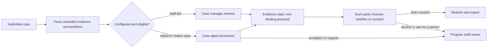

# Aequitas — Evidence-Grounded Dispute Resolution

Aequitas is a bilingual dispute-resolution workspace with staff-led cases and an optional autonomous workflow for configured, eligible retail cases. In agent-managed cases, it can handle intake, evidence and positions through a non-binding, evidence-cited proposal without case-manager action. Each party controls their submissions and consent; exceptions and requests for a person go to program staff.

The case agent is off by default. Its current end-to-end proof uses synthetic cases and a stub model; live-provider quality and production operations remain unverified. It is not an adjudication engine and does not give legal advice.

**Stack:** Next.js, TypeScript, React, Prisma/PostgreSQL, WebAuthn, Vitest, and Playwright.

## Workflow



## Engineering highlights

- Case-level access and claim-write permissions are expressed in domain code.
- Evidence and interpretations retain provenance rather than becoming an unexplained generated answer.
- The case agent is restricted to explicit program rules, evidence-backed proposals, and a closed remedy set; it hands exceptions to staff.
- Both parties make the consent decision, bound to the outcome version they saw.
- Security tests exercise account-takeover prevention and invite-based account claiming.

## Review the implementation

| Question | Start here |
| --- | --- |
| Who can read a case or write a claim? | [Case access](src/domain/caseAccess.ts), [claim permissions](src/domain/claimWrites.ts) |
| How does the autonomous routine path work? | [Case-agent prototype and launch gates](docs/case-agent-prototype.md) |
| How are AI proposals authorized and recorded? | [Pipeline writes](src/domain/pipeline/writes.ts) |
| How is account takeover tested? | [HTTP/WebAuthn regression tests](test/integration/auth-takeover.test.ts) |
| How does the method map to the backend? | [Core backend contract](docs/aequitas-core-backend.md) |
| Which checks run in CI? | [CI workflow](.github/workflows/ci.yml) |

A useful review follows an eligible case through intake, evidence extraction, positions, a structured proposal, party consent, and a staff handoff when a rule or safety check requires one. Human-led cases remain supported. The agent must not turn a proposal into a binding decision or bypass either party's choice.

## Development and verification

Use Node 22 and npm 11 as specified in `package.json`. Configure the database, storage, and authentication environment before starting the application; the backend contract describes the model and operational boundaries.

```sh
npm install
npm run dev
```

Available checks include `npm run lint`, `npm run typecheck`, `npm test`, `npm run build`, and `npm run test:e2e`. Database/storage-backed checks require an isolated configured environment. The repository also provides `npm run seed:demo`; inspect its configuration before using it against a database.

## Scope

This remains a release candidate, not a production-ready automated service. The case agent is optional and disabled until program rules, provider terms, oversight, and legal review are resolved. Legal-context retrieval requires a separately configured source; missing configuration must remain visible. Synthetic tests demonstrate code paths, not live-model quality or readiness for real case data. See [paid-pilot readiness](docs/paid-pilot-readiness.md).

[Paid-pilot readiness and operating gates](docs/paid-pilot-readiness.md)
