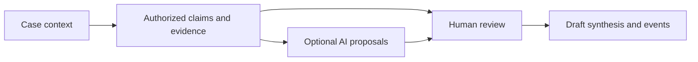

# Aequitas — Evidence and Human Review for Dispute Resolution

Aequitas is a research-led workspace prototype for organizing claims, evidence, competing interpretations, consent, and proposed repair. It keeps draft recommendations separate from decisions and makes human correction part of the workflow.

**Stack:** Next.js, TypeScript, React, Prisma/PostgreSQL, WebAuthn, Vitest, and Playwright.

## Workflow



## Engineering highlights

- Case-level access and claim-write permissions are expressed in domain code.
- Evidence and interpretations retain provenance rather than becoming an unexplained generated answer.
- The optional AI pipeline proposes structured material for review.
- Security tests exercise account-takeover prevention and invite-based account claiming.

## Review the implementation

| Question | Start here |
| --- | --- |
| Who can read a case or write a claim? | [Case access](src/domain/caseAccess.ts), [claim permissions](src/domain/claimWrites.ts) |
| How are AI proposals authorized and recorded? | [Pipeline writes](src/domain/pipeline/writes.ts) |
| How is account takeover tested? | [HTTP/WebAuthn regression tests](test/integration/auth-takeover.test.ts) |
| How does the method map to the backend? | [Core backend contract](docs/aequitas-core-backend.md) |
| Which checks run in CI? | [CI workflow](.github/workflows/ci.yml) |

A useful review follows one case through evidence entry, competing claims, human correction, and a draft synthesis. The point of the prototype is to preserve those distinctions throughout the application.

## Development and verification

Use Node 22 and npm 11 as specified in `package.json`. Configure the database, storage, and authentication environment before starting the application; the backend contract describes the model and operational boundaries.

```sh
npm install
npm run dev
```

Available checks include `npm run lint`, `npm run typecheck`, `npm test`, `npm run build`, and `npm run test:e2e`. Database/storage-backed checks require an isolated configured environment. The repository also provides `npm run seed:demo`; inspect its configuration before using it against a database.

## Scope

This is a workspace prototype, not an automated legal decision-maker. Legal-context retrieval requires a separately configured source; missing configuration must remain visible to the user. Test sources document intended behavior, not a guarantee about every deployment.

[Detailed setup and operating guide](https://github.com/martinlepage26-bit/aequitas/blob/5898e6fa3e2b3ab43e5be20cb243844ee48d9356/README.md)
